# Design and Implementation of an Industrial Pressure Gauge Intelligent Detection and Reading System Based on Deep Learning Yolo11+YOLOv8-Pose Keypoints

[Algorithm Introduction]
This system, tailored for the automation inspection needs of pressure gauges in industrial settings, innovatively integrates deep learning object detection with keypoint localization techniques. The **YOLOv11** model is employed as the main detection framework to achieve rapid recognition of pressure gauges, while the **YOLOv8-Pose** model precisely locates the critical features of the instrument (needle head, center area, start and end points of the range). This establishes a high-precision, low-latency intelligent reading solution. Compared to traditional image segmentation methods based on UNet or DeepLabV3+, this system significantly enhances the robustness and computational efficiency of detection through keypoint detection, effectively addressing issues such as low accuracy and long processing time in complex industrial environments.

**Core Technology Architecture**

1.

1. **YOLOv11 Object Detection Module**

-

- **Function**

Responsible for quickly locating the pressure gauge area from complex industrial backgrounds and outputting the instrument boundary box coordinates.

-

- **Advantages**

YOLO11, as the latest generation of YOLO series models, achieves a balance between detection speed and accuracy through the improved CSPNet backbone network and dynamic label allocation strategy, making it particularly suitable for real-time industrial detection scenarios.

-

1.

1. **YOLOv8-Pose Keypoint Detection Module**

-

- **Strong anti-interference capability**

Key point detection has higher tolerance to light changes, instrument tilting, etc.

-

- **Efficient calculation**

Compared to semantic segmentation models, keypoint detection only requires outputting a small number of coordinates points, and the inference speed is increased by 3-5 times.

-

- **High interpretability**

The key point positioning results can be directly mapped to the physical range, facilitating engineering deployment.

-

-

- **Pointer head**

- Core point for dynamic reading calculation;

-

- **Center Region**

Determine the zero point of the instrument;

-

- **Range Start and End Points**

Define the minimum/maximum range boundaries of a pressure gauge.

-

-

- **Function**

In the detected instrument area, accurately locate the following key points:

-

- **Technical Implementation**

Lightweight keypoint detection architecture based on YOLOv8-Pose, achieving sub-pixel level positioning accuracy through heatmap regression and offset prediction.

-

- **Advantages**

:

-

1.

1. **Reading Calculation Module**

-

- **Algorithm logic**

:

-

- **Accuracy Guarantee**

Keypoint positioning error ≤ 1 pixel, reading absolute error ≤ 0.5% of the scale.

-

1.

1.

Build a geometric model based on the pointer head, center point and range endpoints;

1.

1.

Calculate the angle between the pointer and the range axis, and convert it into actual pressure value based on the range.

1.

1.

Smooth out reading fluctuations through Kalman filtering to enhance stability.

1.

**System Advantages Compared to Traditional Solutions**

**Metrics** || **Key Point Detection System (This system)** || **Traditional Segmentation Scheme (UNet/DeepLabV3+)**

**Detection Speed**

25-30 FPS (GPU)

8-12 FPS (GPU)

**Accuracy**

Keypoint localization error <1px

The division boundary is blurred, resulting in a ±2% error in readings.

**Anti-interference Ability**

Strong (Adapt to tilting, occlusion, reflection)

Weak (dependent on segmentation threshold)

**Deployment complexity**

Lightweight model, easy to deploy on edge devices

Remodeling requires high-performance computing resources.

**Application Scenarios**

-

-

Automated inspection of pressure gauges in petrochemical, power and other industries;

-

-

Real-time feedback of pressure parameters in the vision guidance of industrial robots;

-

-

Intelligent collection and analysis of instrument data in remote monitoring systems.

**Summary**
This system achieves the full process automation from "rough positioning" to "precise reading" in industrial pressure gauge detection through the collaborative optimization of YOLO11 and YOLOv8-Pose. It has reached a leading level in precision, speed, and robustness, providing an efficient and reliable visual inspection solution for the intelligent transformation of industry.

[Effect Display]

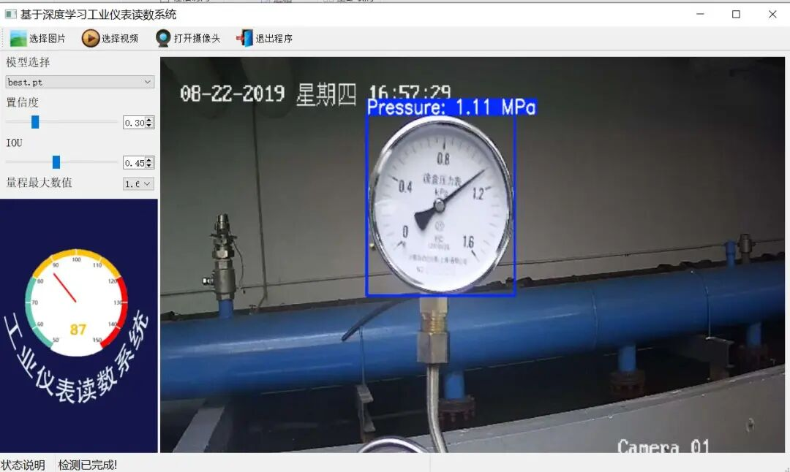Editor

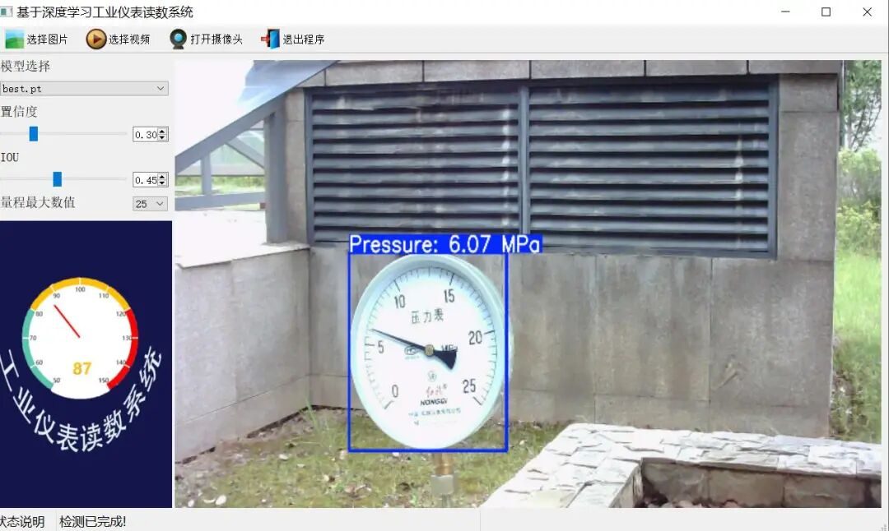Editor

**The system's process for reading instruments mainly includes the following steps:**

Step 1: Use the target detection algorithm, yolo11, to locate the instrument position.

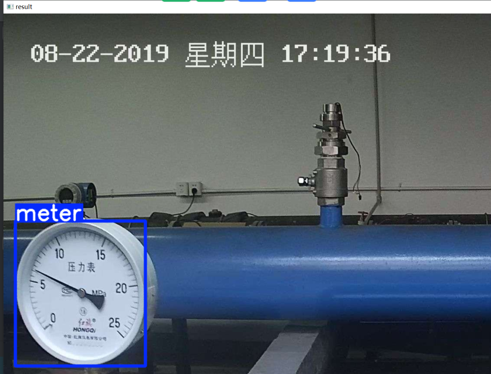Editor

Step 2: Take the instrument position obtained in the first step, crop the instrument image area, and then feed it into the YOLOv8-pose keypoint detection algorithm for keypoint detection.

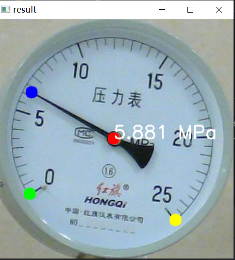Editor

Step 3: The key points extracted are the center area of the instrument. Pointer, Range starting point, Range endpoint. Then calculate the angle of pointer relative to the starting point of range and the angle of the end of range, Determine the reading based on the maximum range of the instrument

Step Four: Display of readings and inspection instruments

[Algorithm Comparison]

Currently, the following algorithms are commonly used for instrument reading online:

Target detection positioning instrument -" Segmentation frame segmentation instrument -" Convert the range of the instrument from circular to rectangular interval. Then, by combining the OpenCV algorithm to obtain the proportion of pointer position in the rectangular area, we can obtain the reading. Typical algorithms include

Object Detection (YOLOv5/YOLOv8/YOLOv11, etc.) - > Segmentation Framework (DeepLabv3Plus/U-Net)

Our algorithm is:

Object Detection (YOLOv11) - > Keypoint Framework (YOLOv8-pose), of course, other detection and keypoint frameworks can also be used, such as YOLOv8, YOLOv12, YOLOv13, Yolo11-pose, etc.

Testing has revealed that the use of a segmentation framework for instrument segmentation typically presents several issues: significant dependency on segmentation accuracy, which can lead to errors in segmentation if the dataset is insufficient. Furthermore, real-time performance is poor, and any segmentation issues can result in incorrect instrument readings. If keypoint detection is employed, it allows for the exclusion of key positions detected by the instrument through keypoint detection. However, if the segmentation framework requires precise detection of each tick mark, this approach is not as convenient as keypoint detection, and the need for extensive code to verify whether each grid's arrow indicator is correctly segmented is evident. Therefore, this algorithm is clearly not optimal.

[Introduction to YOLOv11 Framework]

On September 30, 2024, Ultralytics officially released YOLOv11 during its event YOLOVision. YOLOv11 is the latest version of YOLO, developed by the team from both the United States and Spain. YOLO is a computer model for image-based artificial intelligence.

### Ultralytics YOLO11 Overview

YOLO11 is the latest version of the Ultralytics YOLO series of real-time object detectors, redefining possibilities with cutting-edge precision, speed, and efficiency. Building on impressive advancements from previous YOLO versions, YOLO11 introduces significant improvements in architecture and training methods, making it a versatile choice for various computer vision tasks.

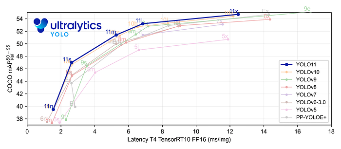Editor

Key Features

-

-

Enhanced feature extraction: YOLO11 employs an improved backbone and neck architecture, enhancing feature extraction capabilities to achieve more precise object detection and complex task performance.

-

-

Optimization for efficiency and speed: YOLO11 introduces refined architecture design and optimized training pipelines, providing faster processing speeds while maintaining the best balance between accuracy and performance.

-

-

Achieving higher accuracy with fewer parameters: With the advancement of model design, YOLOv11m has achieved higher average precision (mAP) on the COCO dataset while using 22% fewer parameters than YOLOv8m, thereby improving computational efficiency without compromising accuracy.

-

-

Cross-environment adaptability: YOLO11 can be seamlessly deployed in various environments, including edge devices, cloud platforms, and systems supporting NVIDIA GPUs, ensuring maximum flexibility.

-

-

Supports a wide range of tasks: whether it's object detection, instance segmentation, image classification, pose estimation, or Oriented Object Detection (OBB), YOLO11 aims to tackle various computer vision challenges.

Editor

#### Compared to previous versions, what are the key improvements in Ultralytics YOLO11?

Ultralytics YOLO11 introduces several significant improvements compared to its predecessor. The main improvements include:

-

-

Enhanced feature extraction: YOLOv11 employs an improved backbone and neck architecture, enhancing feature extraction capabilities to achieve more precise object detection.

-

-

Optimized efficiency and speed: Precise architectural design and optimized training pipelines provide faster processing speeds while maintaining a balance between accuracy and performance.

-

-

Achieving higher accuracy with fewer parameters: YOLOv11m achieves higher average precision (mAP) on the COCO dataset, reducing its parameters by 22% compared to YOLOv8m, while improving computational efficiency without compromising accuracy.

-

-

Cross-environment adaptability: YOLO11 can be deployed across various environments, including edge devices, cloud platforms, and systems with NVIDIA GPUs.

-

-

Supports a wide range of tasks: YOLO11 supports various computer vision tasks, such as object detection, instance segmentation, image classification, pose estimation, and Oriented Object Detection (OBB).

[Introduction to YOLOv8-Pose Framework]

The Backbone, Neck network, and the target detection are exactly the same for keypoint detection, only the Head layer will differ slightly.

Three scale feature maps are generated in the head layer, including three prediction Box feature maps (1, 64, 80, 80), (1, 64, 40, 40), and (1, 64, 20, 20); as well as three prediction CLs feature maps (1, nc, 80, 80), (1, nc, 40, 40), and (1, nc, 20, 20). Additionally, three feature maps for predicting key_point keypoints are generated. Taking the human body's 17 keypoints as an example, the branch generates three scale feature maps respectively (1, 51, 80, 80), (1, 51, 40, 40), and (1, 51, 20, 20), which are used to predict the positions and confidence of the human body's 17 keypoints, represented by the shallow green Head part in the network structure diagram.

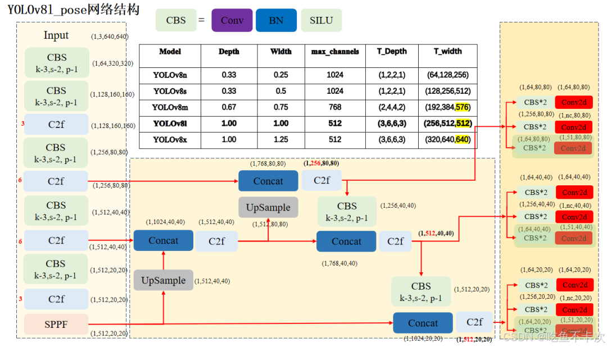Editor

### 3.1 Key Points of the Human Body

51 represents the position (x and y coordinates) and confidence (conf) of 17 key points, i.e., 17 * 3 = 51. The human body's 17 key points and their connections between them are shown below. For example, noise will have connections to both eyes, so the skeleton will include (0,1) and (0,2).

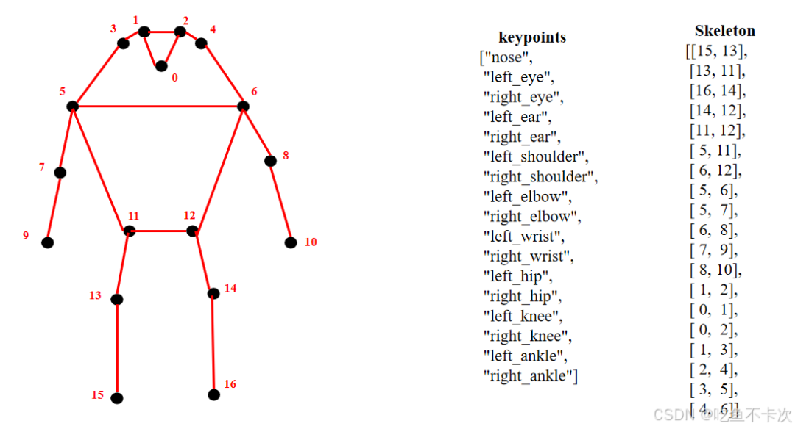Editor

### 3.2 key_point branch

The specific structure of the key_point branch is shown in the blue box area below. This branch consists of two convolutional groups and one convolutional layer. The number of channels in the first two convolutional groups must comply with max(ch[0] // 4, self.nk), where ch[0] represents the number of channels for a 80*80 scale feature map, and self.nk is the number of keypoints multiplied by 3, for example, if the number of keypoints is 17 as mentioned earlier, the final output channel count of the key_point branch will be 17 * 3 = 51.

From the figure, it is evident that in YOLOv8L, the number of channels for the 80 * 80 scale feature maps is 256. Therefore, the number of channels for both the first two convolutional layers in this branch head are calculated to be 64. For example, if we take human keypoints as an example, the last convolutional output has a channel count of 51.

The figure on the right also displays the number of output channels for the head network in other versions (n/s/m/x). This can be verified by using the formula mentioned above. According to the calculation, if the number of output channels for the first two convolutional groups in the n/s/m versions is both 51.

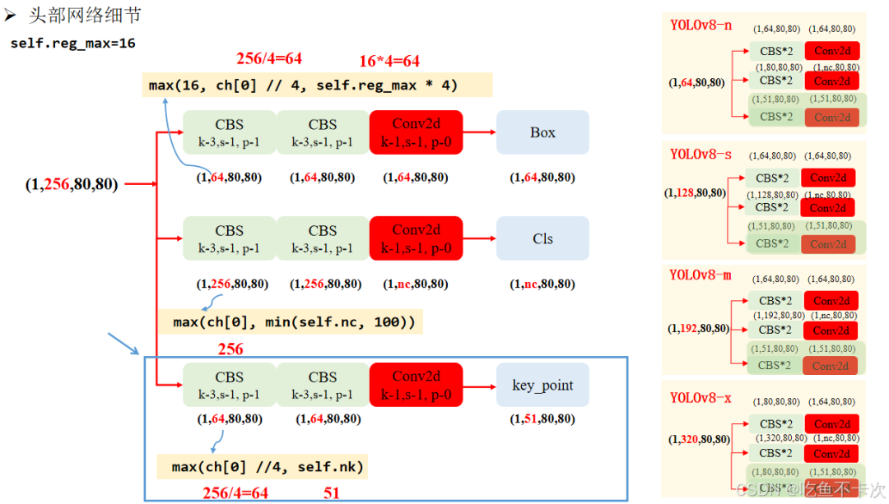Editor

### 3.3 KeyPoint implementation basic principles

YOLOv8 keypoint detection network is based on YOLO PoseMaji_.

Briefly discuss its basic ideas:

(1) A target detection box corresponds to a set of key points.

(2) Key points may be missed due to truncation or occlusion, leading to key point detection failure.

(3) Key points may also be predicted outside the target detection box.

[Test Environment]

windows10 x64

anaconda3+python3.8

ultralytics==8.3.0

torch==2.3.1

[Instrument Testing Dataset Introduction]

Dataset format: Pascal VOC format + YOLO format (txt file without split path, only contains jpg images and corresponding VOC format xml files and yolo format txt files)

Number of images (number of jpg files): 1836

Number of annotations (number of xml files): 1836

Number of annotations (number of txt files): 1836

Labeling category count: 1

Label category name (Note that the order of yolo format categories does not correspond to this, but is based on the labels folder's classes.txt): ["meter"]

Number of boxes labeled in each category:

Meter frame count = 2082

Total frame count: 2082

Using labelImg:

Annotation rules: Draw a rectangle around the category.

Important Notice: No

Special : This dataset does not guarantee the accuracy or precision of the trained models or weight files. The dataset is provided with accurate and reasonable annotations only.

Image Preview:

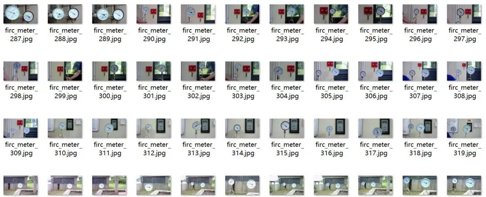

Editor

Annotation example:

Editor

Training results:

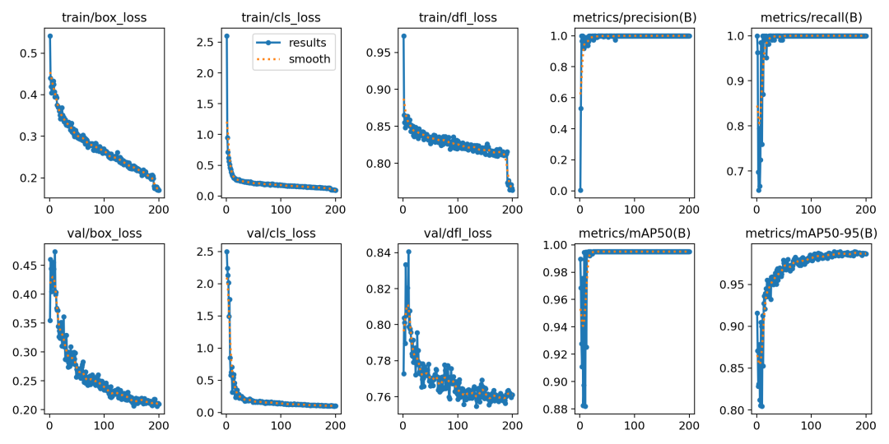Editor

Validation set training accuracy statistics:

Class

Images

Instances

P

R

mAP50

mAP50-95

all

92

108

0.999

1

0.995

0.989

[Instrument Key Points Dataset Introduction]

The dataset consists of a total of 2216 images, as shown below.

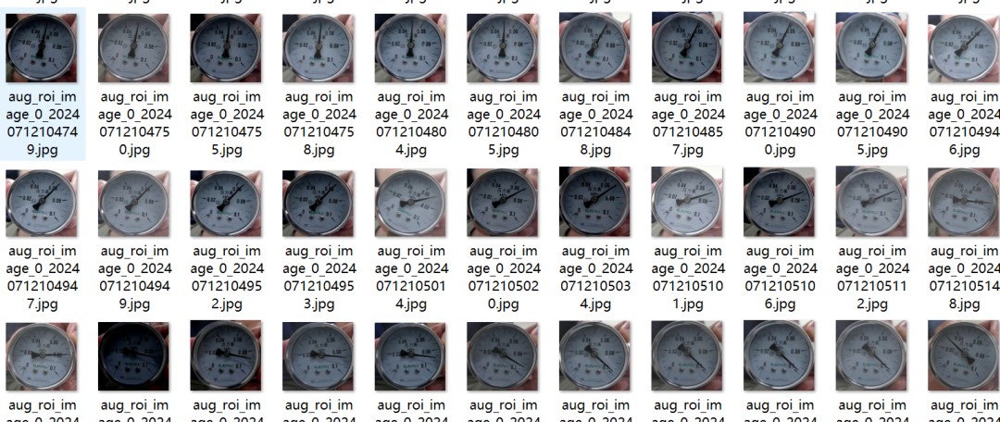Editor

Training results:

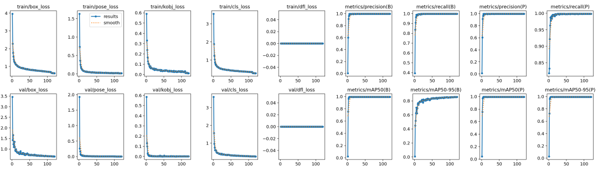Editor

[Provided Files]

Usage Steps:
1. Install the YOLOv11 environment according to the official framework ultralytics installation tutorial, and install PyQt5.
2. Switch to the YOLOv11 environment you have installed, and switch to the source code directory, then execute python main.py to start the interface and perform the corresponding operations.

The provided project files include:
- Python source code
- Complete source code, dataset, model, and training logs for the YOLOv8-pose trainer instrument
- Detection dataset and keypoint detection dataset for the instrument
- Yolov11n.pt detection model and YOLOv8-pose model
Training map, P, R curves (in weights\results.png), and keypoint training logs can be found in the complete source code of the YOLOv8-pose trainer instrument.
Test images (under test_img folder) note that new_001.jpg is a keypoint test image used for testing + reading recognition purposes.

Full set of project source code (including source code, dataset, and model) download link:

## Payment

Here is a pay link on Stripe ( https://buy.stripe.com/3cs8yP7sY87d0vu9AB ). Please contact me lonlonago@foxmail.com after funding $89, and I will send you a complete data files , thank you!

